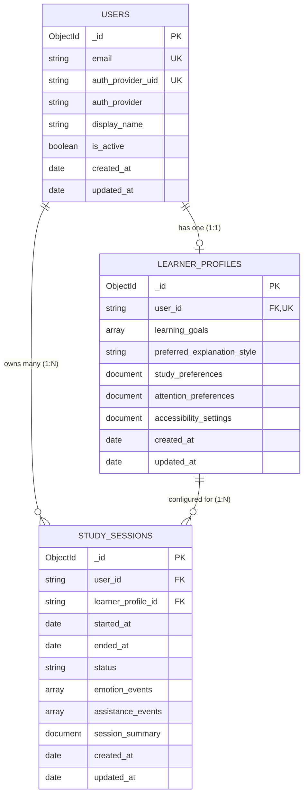

# CAMBER — Sprint 1: MongoDB Database Schema Design & Validation Documentation
**Cognitive Assistance and Mood-Based Educational Responder**

---

## 1. Overview and Scope

This document provides the definitive database schema architecture, Pydantic v2 validation constraints, relationship mapping, index specifications, and privacy guidelines for **CAMBER** (Sprint 1).

CAMBER is an emotion-aware study companion designed to personalize learning, mitigate cognitive fatigue, and provide timely, gentle interventions. To deliver this experience while adhering to strict privacy and data-minimization principles, the persistent data layer is partitioned into three decoupled MongoDB collections:

1. **`users`**: Minimum account identity and external authentication linkage.
2. **`learner_profiles`**: User-defined study preferences, pacing, and accessibility accommodations.
3. **`study_sessions`**: Temporal study sessions, bounded emotion model predictions, assistance intervention logs, and session reflections.

---

## 2. Verified Existing Architecture Findings

Prior to designing this schema, an exhaustive repository inspection was performed across the backend codebase:

| Architectural Component | Verified Implementation in Repository |
|---|---|
| **Backend Framework** | FastAPI (`backend/app/main.py`) with Uvicorn server |
| **Authentication Engine** | Firebase Authentication (`backend/app/firebase.py`, `backend/app/routes/auth.py`) |
| **Authentication Token** | Firebase ID Token (JWT) verified via Firebase Admin SDK in `backend/app/dependencies.py` (`get_current_user`) |
| **Current User Identifier** | Stable Firebase UID string (`uid`, e.g. `aB3xYz9872...`) |
| **Validation Engine** | Pydantic v2 (`pydantic>=2.0.0` in `requirements.txt`, using `Field(..., json_schema_extra={...})`) |
| **Supported AI Emotion Labels** | DAISEE dataset transfer learning pipeline (`MobileNetV2_Transfer` in `train_pipeline.ipynb` and `realtime_detect.ipynb`): `Confused`, `Focused`, `Frustrated`, `Bored`, `Drowsy`, `Looking Away` |
| **Client Applications** | React 19 Frontend (`frontend/src/`) and Chrome Extension Manifest V3 (`extension/`) |

---

## 3. Database & Authentication Approach

### 3.1 External Identity vs. MongoDB Document Identity
- **Authentication Provider**: Firebase Authentication is the sole credential and authentication authority. The backend never stores plaintext passwords, salt hashes, or security tokens in MongoDB.
- **Identity Decoupling**:
  - `auth_provider_uid`: The external, immutable Firebase UID (`str`) representing the user identity.
  - `_id`: The native MongoDB `ObjectId` (24-character hexadecimal) identifying the document record within MongoDB.
  - Foreign key references in child collections (`learner_profiles.user_id` and `study_sessions.user_id`) reference the verified user identity consistently.



---

## 4. Collection Schemas & Field Specifications

### 4.1 Collection: `users`
**Purpose**: Stores minimal account-related metadata linking the authenticated Firebase identity to the CAMBER database.

| Field Name | MongoDB BSON Type | Required? | Default Value | Description & Constraints |
|---|---|---|---|---|
| `_id` | `ObjectId` | Optional (Auto) | Auto-generated | MongoDB primary key identifier (24-char hex). |
| `email` | `String` | **Required** | None | Normalized (lowercase, trimmed) user email. Unique index. |
| `display_name` | `String` | Optional | `null` | Chosen display or preferred student name (max 100 chars). |
| `auth_provider` | `String` | **Required** | `"firebase"` | Authentication mechanism. Constant identifier. |
| `auth_provider_uid` | `String` | **Required** | None | Stable external Firebase UID. Unique index. |
| `is_active` | `Boolean` | **Required** | `true` | Account operational status indicator. |
| `created_at` | `Date` | **Required** | Current UTC | Timestamp when user record was first registered. |
| `updated_at` | `Date` | **Required** | Current UTC | Timestamp of last user document modification. |

---

### 4.2 Collection: `learner_profiles`
**Purpose**: Stores user-configured pedagogical preferences, session timing defaults, and accessibility accommodations. Kept strictly separate from authentication credentials.

| Field Name | MongoDB BSON Type | Required? | Default Value | Description & Constraints |
|---|---|---|---|---|
| `_id` | `ObjectId` | Optional (Auto) | Auto-generated | Profile identifier. |
| `user_id` | `String` / `ObjectId` | **Required** | None | Foreign reference to user document identity. Unique index enforces 1:1 profile ownership. |
| `learning_goals` | `Array[String]` | Optional | `[]` | Up to 20 user-defined learning goals or subjects. |
| `preferred_explanation_style` | `String` | **Required** | `"simple"` | One of: `["simple", "detailed", "visual", "analogy", "step_by_step"]`. |
| `study_preferences` | `Document` | **Required** | Nested Defaults | Embedded document containing timing and cadence rules. |
| `study_preferences.session_duration_minutes` | `Integer` | **Required** | `25` | Target focus interval (Pomodoro duration, 5 to 240 mins). |
| `study_preferences.break_duration_minutes` | `Integer` | **Required** | `5` | Short restorative break interval (1 to 60 mins). |
| `study_preferences.learning_pace` | `String` | **Required** | `"moderate"` | Pacing speed: `["gentle", "moderate", "intensive"]`. |
| `study_preferences.reminder_frequency` | `String` | **Required** | `"normal"` | Check-in frequency: `["low", "normal", "high"]`. |
| `strengths` | `Array[String]` | Optional | `[]` | User-reported conceptual strengths (max 20 items). |
| `areas_for_improvement` | `Array[String]` | Optional | `[]` | Targeted areas for deeper practice (max 20 items). |
| `attention_preferences` | `Document` | **Required** | Nested Defaults | Environmental focus preferences. |
| `attention_preferences.prefer_break_reminders` | `Boolean` | **Required** | `true` | Flag enabling proactive pause cues. |
| `attention_preferences.break_reminder_interval_minutes` | `Integer` | **Required** | `25` | Interval threshold before suggesting rest. |
| `attention_preferences.background_sounds` | `String` | **Required** | `"none"` | Audio cue setting: `["none", "white_noise", "nature", "soft_ambient"]`. |
| `accessibility_settings` | `Document` | **Required** | Nested Defaults | Non-medical sensory and display accommodations. |
| `accessibility_settings.reading_assistance` | `Boolean` | **Required** | `false` | Formatting assistance for reading ease. |
| `accessibility_settings.text_to_speech` | `Boolean` | **Required** | `false` | Text-to-speech audio narration preference. |
| `accessibility_settings.font_size_preference` | `String` | **Required** | `"standard"` | Text size: `["standard", "large", "extra_large"]`. |
| `accessibility_settings.high_contrast_mode` | `Boolean` | **Required** | `false` | High contrast visual palette. |
| `accessibility_settings.reduced_motion` | `Boolean` | **Required** | `false` | Disables non-essential animated elements. |
| `accessibility_settings.adaptive_pacing` | `Boolean` | **Required** | `true` | Allows Camber to gently adapt suggestions upon fatigue. |
| `created_at` | `Date` | **Required** | Current UTC | Timestamp of profile creation. |
| `updated_at` | `Date` | **Required** | Current UTC | Timestamp of latest profile update. |

---

### 4.3 Collection: `study_sessions`
**Purpose**: Records session lifecycle, bounded emotion-inference events, proactive assistance interventions, and qualitative summaries.

| Field Name | MongoDB BSON Type | Required? | Default Value | Description & Constraints |
|---|---|---|---|---|
| `_id` | `ObjectId` | Optional (Auto) | Auto-generated | Primary key session identifier. |
| `user_id` | `String` / `ObjectId` | **Required** | None | Reference to session owner. Indexed. |
| `learner_profile_id` | `String` / `ObjectId` | Optional | `null` | Reference to the learner profile active during session. |
| `started_at` | `Date` | **Required** | Current UTC | Session start timestamp. Indexed. |
| `ended_at` | `Date` | Optional | `null` | Nullable while session is active. Must be `>= started_at`. |
| `status` | `String` | **Required** | `"active"` | Lifecycle state: `["active", "completed", "paused", "abandoned"]`. |
| `emotion_events` | `Array[Document]` | Optional | `[]` | Bounded array of emotion inference events (**max 500 items**). |
| `assistance_events` | `Array[Document]` | Optional | `[]` | Bounded array of assistance interventions (**max 200 items**). |
| `session_summary` | `Document` / `String`| Optional | `null` | Summary record detailing duration, dominant emotion, and notes. |
| `created_at` | `Date` | **Required** | Current UTC | Record creation timestamp. |
| `updated_at` | `Date` | **Required** | Current UTC | Record modification timestamp. |

#### Subdocument: `emotion_events`
Each embedded event captures an uncertain, point-in-time model classification:
- `timestamp`: `Date` (UTC timestamp)
- `predicted_label`: `String` (Validated against supported AI model classes: `"confused"`, `"focused"`, `"frustrated"`, `"bored"`, `"drowsy"`, `"looking_away"` and aliases `"engaged"`, `"stressed"`, `"fatigued"`)
- `confidence`: `Double` (Normalized prediction confidence score: `0.0 <= confidence <= 1.0`)
- `model_version`: `String` (Default: `"MobileNetV2_Transfer_v1"`)

#### Subdocument: `assistance_events`
Each embedded event captures an assistance intervention actually delivered:
- `timestamp`: `Date` (UTC timestamp)
- `assistance_type`: `String` (One of: `["explain_simply", "generate_quiz", "suggest_break", "emotion_check", "pacing_adjustment"]`)
- `reason`: `String` (e.g., `"Consecutive confused states detected in topic: Stack LIFO"`, max 250 chars)
- `action_details`: `Document` (Structured metadata key-values, e.g. `{"quiz_id": "quiz_42", "response_received": true}`)

#### Subdocument: `session_summary`
- `total_duration_minutes`: `Integer` (Calculated duration)
- `predominant_emotion`: `String` (Most frequent state recorded)
- `total_assistance_provided`: `Integer` (Count of assistance interventions)
- `notes`: `String` (Student reflection or AI-generated takeaway)

---

## 5. Relationships & Integrity Constraints

```text
users._id (1) ───────────── (1) learner_profiles.user_id
users._id (1) ───────────── (N) study_sessions.user_id
learner_profiles._id (0..1) ── (N) study_sessions.learner_profile_id
```

1. **One-to-One (`users` &leftrightarrow; `learner_profiles`)**:
   - Each user maintains exactly one active `learner_profile`.
   - Enforced by a **unique index** on `learner_profiles.user_id`.
2. **One-to-Many (`users` &leftrightarrow; `study_sessions`)**:
   - Each study session is owned by a single user.
   - Compound index on `(user_id, started_at)` supports fast historical session queries.
3. **Optional Reference (`learner_profiles` &leftrightarrow; `study_sessions`)**:
   - A study session optionally references the `learner_profile_id` under which it occurred, preserving the profile snapshot context.

---

## 6. Index Definitions & Performance Optimization

The following indexes are designed to support CAMBER's query access patterns:

```javascript
// 1. USERS COLLECTION
db.users.createIndex(
  { "auth_provider_uid": 1 },
  { unique: true, name: "idx_users_auth_provider_uid" }
);
db.users.createIndex(
  { "email": 1 },
  { unique: true, name: "idx_users_email_unique" }
);

// 2. LEARNER_PROFILES COLLECTION
db.learner_profiles.createIndex(
  { "user_id": 1 },
  { unique: true, name: "idx_learner_profiles_user_id_unique" }
);

// 3. STUDY_SESSIONS COLLECTION
db.study_sessions.createIndex(
  { "user_id": 1, "started_at": -1 },
  { name: "idx_study_sessions_user_history" }
);
db.study_sessions.createIndex(
  { "user_id": 1, "status": 1 },
  { name: "idx_study_sessions_user_status" }
);
```

### Index Purpose Analysis:
- `idx_users_auth_provider_uid`: O(1) lookup during token verification in `get_current_user` dependency.
- `idx_users_email_unique`: Prevents duplicate email account registrations.
- `idx_learner_profiles_user_id_unique`: Guarantees one profile per learner while providing immediate retrieval on session launch.
- `idx_study_sessions_user_history`: Supports fast pagination for student progress history sorted by most recent session.
- `idx_study_sessions_user_status`: Allows quick lookup of any currently `"active"` session to prevent orphaned concurrent sessions.

---

## 7. Example Document Instances

### 7.1 Example `users` Document
```json
{
  "_id": { "$oid": "671fd8a2e1b4c91a82340001" },
  "email": "chahat@gmail.com",
  "display_name": "Chahat",
  "auth_provider": "firebase",
  "auth_provider_uid": "fB93kLqZ1mO8wV2xYr4",
  "is_active": true,
  "created_at": { "$date": "2026-10-15T09:30:00.000Z" },
  "updated_at": { "$date": "2026-10-15T09:30:00.000Z" }
}
```

### 7.2 Example `learner_profiles` Document
```json
{
  "_id": { "$oid": "671fd8a2e1b4c91a82340002" },
  "user_id": "fB93kLqZ1mO8wV2xYr4",
  "learning_goals": [
    "Master Data Structures (Stacks & Queues)",
    "Prepare for Final-Year Project Defense"
  ],
  "preferred_explanation_style": "simple",
  "study_preferences": {
    "session_duration_minutes": 25,
    "break_duration_minutes": 5,
    "learning_pace": "moderate",
    "reminder_frequency": "normal"
  },
  "strengths": [
    "Logical reasoning",
    "Conceptual curiosity"
  ],
  "areas_for_improvement": [
    "Time complexity analysis",
    "Recursion debugging"
  ],
  "attention_preferences": {
    "prefer_break_reminders": true,
    "break_reminder_interval_minutes": 25,
    "background_sounds": "nature"
  },
  "accessibility_settings": {
    "reading_assistance": false,
    "text_to_speech": false,
    "font_size_preference": "standard",
    "high_contrast_mode": false,
    "reduced_motion": false,
    "adaptive_pacing": true
  },
  "created_at": { "$date": "2026-10-15T09:35:00.000Z" },
  "updated_at": { "$date": "2026-10-20T14:15:00.000Z" }
}
```

### 7.3 Example `study_sessions` Document
```json
{
  "_id": { "$oid": "671fd8a2e1b4c91a82340003" },
  "user_id": "fB93kLqZ1mO8wV2xYr4",
  "learner_profile_id": "671fd8a2e1b4c91a82340002",
  "started_at": { "$date": "2026-10-28T10:00:00.000Z" },
  "ended_at": { "$date": "2026-10-28T10:30:00.000Z" },
  "status": "completed",
  "emotion_events": [
    {
      "timestamp": { "$date": "2026-10-28T10:05:00.000Z" },
      "predicted_label": "focused",
      "confidence": 0.94,
      "model_version": "MobileNetV2_Transfer_v1"
    },
    {
      "timestamp": { "$date": "2026-10-28T10:14:30.000Z" },
      "predicted_label": "confused",
      "confidence": 0.88,
      "model_version": "MobileNetV2_Transfer_v1"
    },
    {
      "timestamp": { "$date": "2026-10-28T10:22:00.000Z" },
      "predicted_label": "drowsy",
      "confidence": 0.81,
      "model_version": "MobileNetV2_Transfer_v1"
    }
  ],
  "assistance_events": [
    {
      "timestamp": { "$date": "2026-10-28T10:15:00.000Z" },
      "assistance_type": "explain_simply",
      "reason": "Repeated confusion detected during Stack LIFO reading",
      "action_details": {
        "concept": "Stack LIFO principle",
        "action_taken": "Displayed simplified card with real-world cafeteria tray analogy"
      }
    },
    {
      "timestamp": { "$date": "2026-10-28T10:23:00.000Z" },
      "assistance_type": "suggest_break",
      "reason": "Drowsiness prediction detected after 23 minutes of focus",
      "action_details": {
        "break_duration_offered": 5,
        "accepted": true
      }
    }
  ],
  "session_summary": {
    "total_duration_minutes": 30,
    "predominant_emotion": "focused",
    "total_assistance_provided": 2,
    "notes": "Reviewed Stack data structures and took a 5-minute break when tired."
  },
  "created_at": { "$date": "2026-10-28T10:00:00.000Z" },
  "updated_at": { "$date": "2026-10-28T10:30:00.000Z" }
}
```

---

## 8. Privacy, Data Minimization & Ethical Boundaries

CAMBER is an empathetic learning companion designed under strict **Privacy by Design** principles:

1. **Zero Video / Raw Frame Persistence**:
   - Webcam frames and video streams processed by OpenCV are **strictly processed in volatile RAM memory**.
   - Raw video, individual frames, facial landmark coordinates, and raw biometric images are **never stored** in MongoDB, on disk, or transferred over external networks.
2. **Uncertain Model Predictions (Not Psychological Diagnoses)**:
   - Emotion records represent statistical model inferences (`confidence: float`) output from a MobileNetV2 classifier trained on the DAISEE dataset.
   - They are documented and presented as **transient engagement and cognitive feedback indicators**, never as clinical assessments or medical diagnoses.
3. **Bounded Embedded Arrays**:
   - Embedded arrays in `study_sessions` are bounded at the validation layer:
     - `emotion_events`: Maximum **500 records** per session.
     - `assistance_events`: Maximum **200 records** per session.
   - At an average size of ~120 bytes per event, a completed session document requires less than 75 KB—well below MongoDB's 16 MB BSON document limit.
4. **Future Event-Storage Strategy (Scale Horizon)**:
   - When session sampling frequency increases (e.g. continuous 1 Hz logging), events should transition to a time-series collection pattern (`study_session_events` bucketed by minute) with automatic TTL expiry, preserving the `study_sessions` collection for aggregated session summaries.
5. **Non-Medical Accessibility Preferences**:
   - Accessibility settings (`high_contrast_mode`, `reduced_motion`, `reading_assistance`) capture user ergonomics, avoiding any medical diagnostic categorization.

---

## 9. Verification & Local Testing Guide

### 9.1 Environment Variables
Copy and configure database settings in `backend/.env`:
```env
MONGODB_URI=mongodb://localhost:27017
MONGODB_DATABASE=camber_db
```

### 9.2 Running Unit Tests
Execute the schema test suite with pytest from the `backend/` directory:
```bash
cd backend
pytest tests/test_schemas.py -v
```

The test suite validates:
- [x] Document creation and default values.
- [x] Email normalization and syntax validation.
- [x] Valid 24-character hexadecimal ObjectId checking.
- [x] Rejection of malformed ObjectIds.
- [x] All 6 DAISEE model emotion labels (`confused`, `focused`, `frustrated`, `bored`, `drowsy`, `looking_away`).
- [x] Synonym normalization (`engaged`, `stressed`, `fatigued`).
- [x] Confidence boundary enforcement (`0.0 <= confidence <= 1.0`).
- [x] Session chronological date ordering (`ended_at >= started_at`).
- [x] Array size boundary checks preventing unbounded document expansion.

